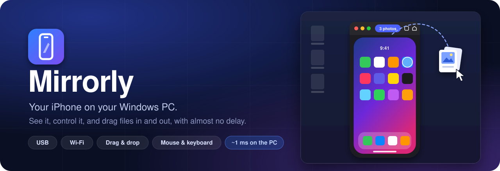
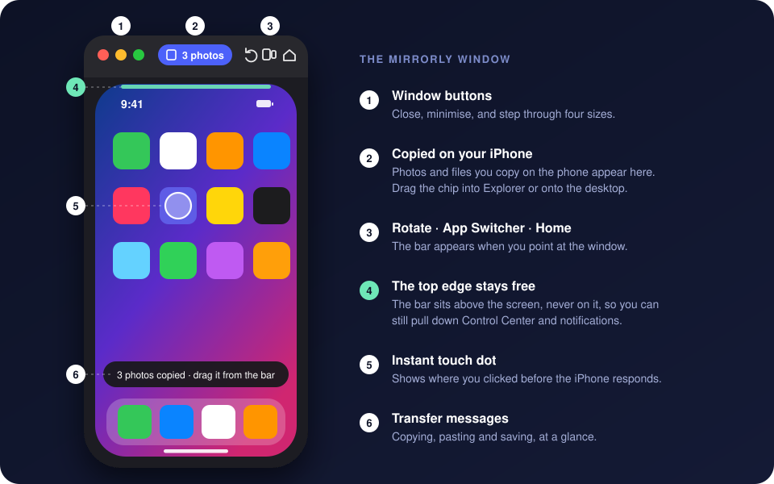
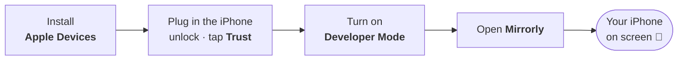
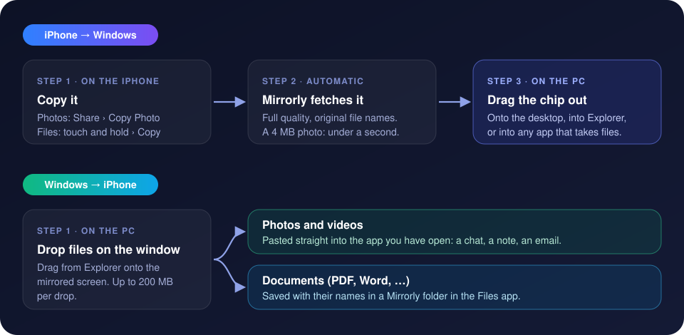
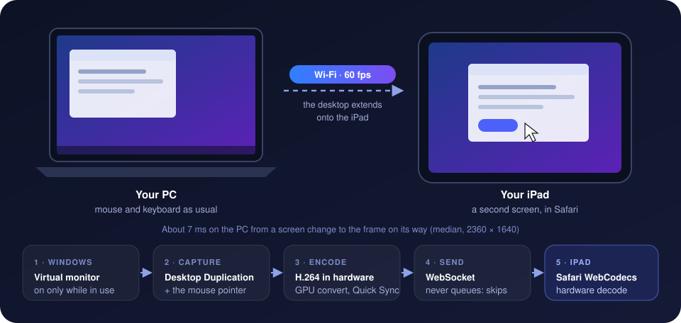
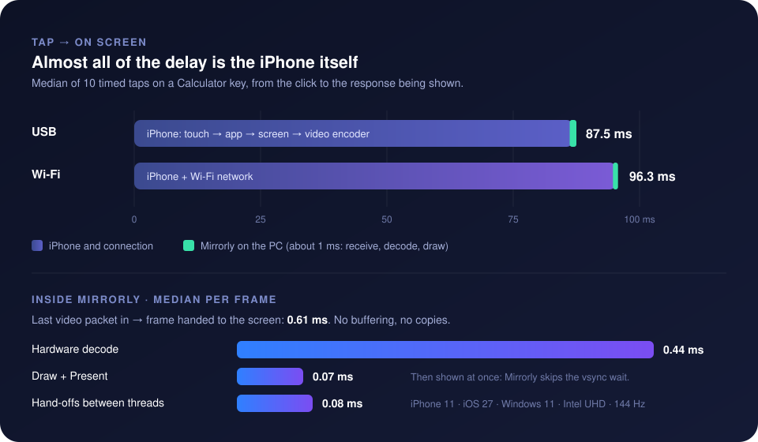
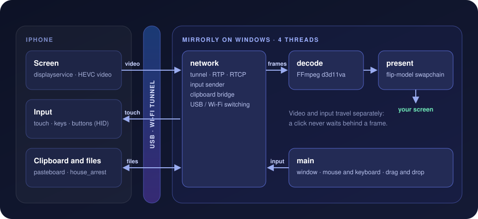

<p align="center">
  
</p>

<p align="center">
  <a href="../../releases/latest"></a>
  <a href="../../actions/workflows/ci.yml"></a>
  <a href="../../releases"></a>
  
  
  
  <a href="LICENSE"></a>
</p>

<p align="center">
  <a href="#download"><b>Download</b></a> ·
  <a href="#get-started">Get started</a> ·
  <a href="#using-mirrorly">Using it</a> ·
  <a href="#drag-and-drop-files">Drag &amp; drop</a> ·
  <a href="#screenshots-and-recordings">Record</a> ·
  <a href="#ipad-as-a-second-display">iPad display</a> ·
  <a href="#usb-and-wi-fi">USB &amp; Wi-Fi</a> ·
  <a href="#performance">Performance</a> ·
  <a href="#faq">FAQ</a> ·
  <a href="../../wiki">Wiki</a> ·
  <a href="#for-developers">Developers</a>
</p>

---

**Mirrorly** puts your iPhone's screen in a window on your PC and lets you use
it with your mouse and keyboard: tap, swipe, scroll, type, and move photos and
files between the two by dragging them. It works over a USB cable or your
Wi-Fi, needs no Mac, no jailbreak and no account, and adds only about **1 ms**
of delay on the PC. It takes screenshots and records the screen, and an iPad
can also be a **second monitor** for the PC.

> Everything stays between your PC and your iPhone. Nothing is uploaded, and
> Mirrorly has no servers, accounts or telemetry.

## Highlights

<table>
  <tr>
    <td width="33%" valign="top">
      <h3>⚡ Low latency</h3>
      Hardware video decoding straight into the window, with no buffering and
      no copies. The PC adds about 1 ms; the rest is the iPhone itself.
    </td>
    <td width="33%" valign="top">
      <h3>🖱️ Full control</h3>
      Click to tap, drag to swipe, scroll with the wheel, and type with your
      keyboard. Ctrl shortcuts work like ⌘ on the iPhone.
    </td>
    <td width="33%" valign="top">
      <h3>📂 Drag &amp; drop, one clipboard</h3>
      Drag photos and files between the iPhone and Windows. Copy on one,
      paste on the other: text, pictures and files.
    </td>
  </tr>
  <tr>
    <td valign="top">
      <h3>📶 USB and Wi-Fi</h3>
      Connect by cable once, then unplug: it carries on over Wi-Fi. Plug in
      again and it's back on USB in about a second.
    </td>
    <td valign="top">
      <h3>🪟 Looks like a Mac</h3>
      Just the phone screen in a rounded window. A bar above it holds the
      buttons and never covers Control Center.
    </td>
    <td valign="top">
      <h3>🧭 Guided setup</h3>
      A welcome screen walks you through the first connection and ticks off
      each step as it happens.
    </td>
  </tr>
  <tr>
    <td colspan="2" valign="top">
      <h3>🖥️ iPad as a second display</h3>
      One click turns an iPad into an extra monitor for Windows: Mirrorly
      opens it in Safari on the iPad by itself. Drag windows onto it and use
      it with your mouse and keyboard, at the iPad's full resolution and
      60 fps. Nothing to install on the iPad.
    </td>
    <td valign="top">
      <h3>🎬 Screenshots &amp; recordings</h3>
      <kbd>F6</kbd> saves a screenshot, <kbd>F7</kbd> records the screen: the
      phone's own video, not re-encoded, so it costs nothing.
    </td>
  </tr>
</table>

<p align="center">
  
</p>

## Download

Get the latest version from **[Releases](../../releases/latest)**.

| File | What it is |
|---|---|
| **`Mirrorly-Setup-x.y.z.exe`** | Installer. No administrator rights needed; adds a Start-menu shortcut and an uninstaller. Recommended. |
| `Mirrorly-x.y.z-portable.zip` | Unzip anywhere and run `Mirrorly.exe`. Nothing is installed. |
| `SHA256SUMS.txt` | Checksums to verify your download. |

> [!NOTE]
> Mirrorly isn't code-signed yet, so Windows SmartScreen may warn the first
> time. Choose **More info › Run anyway**, or check the file against
> `SHA256SUMS.txt` first.

### Requirements

| | Minimum | Recommended |
|---|---|---|
| **PC** | Windows 10 (1809) x64 | Windows 11 |
| **iPhone or iPad** | iOS / iPadOS 27, with a passcode set | the latest version |
| **Driver** | [Apple Devices](https://apps.microsoft.com/detail/9np83lwlpz9k) from the Microsoft Store (free) | |
| **Wi-Fi** *(optional)* | PC and iPhone on the same network | 5 GHz |
| **iPad display** *(optional)* | iPad and PC on the same Wi-Fi; administrator rights once, to install the display driver | 5 GHz, a PC with Intel Quick Sync |

## Get started



1. **Install [Apple Devices](https://apps.microsoft.com/detail/9np83lwlpz9k)**
   from the Microsoft Store. It provides the driver Windows needs to talk to an
   iPhone. The Mirrorly installer offers to open the Store page if it's missing.
2. **Plug in your iPhone or iPad, unlock it and tap Trust**, then enter your
   passcode. If it has forgotten this PC, Mirrorly asks it to trust the PC
   again by itself.
3. **Turn on Developer Mode:** *Settings › Privacy & Security › Developer Mode
   › On*. The iPhone restarts; unlock it and tap **Turn On**.
   If the switch isn't there yet, open Mirrorly once with the iPhone plugged
   in: it asks iOS to show it.
4. **Open Mirrorly.** The first time, a welcome screen ticks off each step as it
   happens.

> [!TIP]
> On the first connection Mirrorly sets up Apple's developer services on the
> iPhone (the same signed disk image Xcode uses). It takes a moment, and may
> happen again after the iPhone restarts.

## Using Mirrorly

### Mouse

| Do this | To |
|---|---|
| **Click** / **drag** on the screen | Tap / swipe |
| **Mouse wheel** | Scroll |
| **Drag up from the very bottom edge** | Go Home (pause before letting go for the App Switcher); works in landscape too |
| **Drag down from the top edge** | Notification Center (left) or Control Center (right) |
| **Right-click** | Go Home |
| **Point at the window** | Show the bar: window buttons, copied files, Disconnect, Screenshot, Record, Rotate, App Switcher, Home |
| **Drag the bar** | Move the window |
| **Ctrl + wheel** or the **green button** | Make the window bigger or smaller |

### Keyboard

Typing goes straight to the iPhone, like a Bluetooth keyboard.

| Keys | Action |
|---|---|
| <kbd>Ctrl</kbd> <kbd>C</kbd> / <kbd>V</kbd> / <kbd>X</kbd> / <kbd>A</kbd> / <kbd>Z</kbd> | Copy, paste, cut, select all, undo (sent as ⌘) |
| <kbd>Ctrl</kbd> <kbd>1</kbd> &nbsp;·&nbsp; <kbd>F1</kbd> | Home |
| <kbd>Ctrl</kbd> <kbd>2</kbd> &nbsp;·&nbsp; <kbd>F2</kbd> | App Switcher |
| <kbd>Ctrl</kbd> <kbd>3</kbd> | Spotlight search |
| <kbd>F3</kbd> | Lock (side button) |
| <kbd>F4</kbd> / <kbd>F5</kbd> | Volume down / up |
| <kbd>F6</kbd> | Screenshot (Pictures › Mirrorly) |
| <kbd>F7</kbd> | Start / stop recording (Videos › Mirrorly) |
| <kbd>F11</kbd> | Fullscreen |
| <kbd>F12</kbd> / <kbd>Shift</kbd> <kbd>F12</kbd> | Rotate the view for landscape apps |

> The iPhone always sends its screen upright, so when an app turns sideways,
> rotate the view with <kbd>F12</kbd> or the rotate button.

### Disconnect and switch iPhones

Click the **power button** on the bar to disconnect. Mirrorly lets go of the
iPhone (the camera and microphone are free again) and stays disconnected,
even if the iPhone is plugged in or on the same Wi-Fi, until you choose to
connect.

The disconnected screen lists every iPhone Mirrorly knows:

| You see | Means |
|---|---|
| 🟢 **Plugged in** | connected by cable; click it to mirror over USB |
| **Wi-Fi, when nearby** | connected to this PC before; click it to find it on your network |
| **Forget** | remove its Wi-Fi pairing (plug it in again to use it) |

To use **another iPhone**, disconnect, plug the other one in and click it.
The first time, unlock it, tap **Trust** and turn on Developer Mode, just
like the first phone. If two iPhones are plugged in at once, Mirrorly asks
which one to mirror.

## Drag and drop files

<p align="center">
  
</p>

### iPhone → Windows

1. On the iPhone, **copy** what you want:
   - **Photos:** open a photo › **Share** › **Copy Photo**. To send several,
     tap **Select**, pick them, then **Share › Copy Photos**.
   - **Files:** touch and hold a file › **Copy**.
2. Mirrorly fetches it straight away and shows *"Photo copied · drag it from the
   bar"*.
3. Point at the window and **drag the blue chip** on the bar onto the desktop,
   into an Explorer folder, or into any app that accepts files.

Files keep their original names (`Invoice.pdf` stays `Invoice.pdf`). Photos are
named by date and time.

### Windows → iPhone

Drag files from Explorer and **drop them on the mirrored screen**.

| You drop | What happens on the iPhone |
|---|---|
| **Photos and videos** | Pasted into the app you have open (a chat, a note, an email), as if you pressed ⌘V there. |
| **Documents** (PDF, Word, Excel, text, …) | Saved with their names in **Files › On My iPhone › *app* › Mirrorly**, and also put on the clipboard so you can paste them into a chat. |

> [!TIP]
> iOS doesn't let other programs write to the top level of *On My iPhone*, so
> documents go into a **Mirrorly** folder inside the Files folder of an app
> that shares files (VLC or Chrome, for example). In Files, touch and hold that
> folder and choose **Favorite**: it then shows in the sidebar as **Mirrorly**.

<details>
<summary><b>Limits and details</b></summary>

- Up to 200 MB per drop. Folders aren't sent; drop the files inside them.
- Copied text goes to the Windows clipboard; see [Shared clipboard](#shared-clipboard).
- To paste a photo into a **Files** folder, click an empty spot in the folder
  first so the paste lands there.
- Fetched files are kept in `%LOCALAPPDATA%\Mirrorly\clipboard` until you copy
  something else.

</details>

## Shared clipboard

Copy on one, paste on the other, while Mirrorly is connected.

| You copy | On | Then |
|---|---|---|
| Text or a picture | Windows | Paste on the iPhone: **Ctrl+V** in Mirrorly, or touch and hold › **Paste** |
| Files (in Explorer) | Windows | Press **Ctrl+V** in Mirrorly: photos are pasted, documents saved by name |
| Text | iPhone | **Ctrl+V** anywhere on the PC |
| Photos or files | iPhone | **Ctrl+V** into Explorer, a chat or an email; a photo also pastes as a picture into Paint, Word and the like |

Whichever was copied last wins: copy on the iPhone after the PC, and Ctrl+V
in Mirrorly pastes the iPhone's copy.

> [!NOTE]
> Passwords stay put. Anything a password manager marks as private on the PC
> is never sent to the iPhone, and text that comes from the iPhone is kept out
> of Windows' clipboard history and cloud clipboard. On the iPhone, the paste
> suggestion above the keyboard reads *"Paste from dtpasteboardd"*: that is the
> iOS service Mirrorly hands the copy to.

## Screenshots and recordings

| Press | Or on the bar | What you get |
|---|---|---|
| <kbd>F6</kbd> | the camera button | A PNG of the screen in **Pictures › Mirrorly**, at full resolution |
| <kbd>F7</kbd> | the record button (a red stop button while recording) | An MP4 of the screen in **Videos › Mirrorly**; press again to finish |

Both are turned the way you have the view turned (<kbd>F12</kbd>), and named
by the time they were taken.

A recording is the phone's own video stream, written to the file as it
arrives: nothing is re-encoded, so it costs next to nothing, keeps the
phone's quality, and doesn't slow the mirror down. The file is HEVC video in
MP4, like the iPhone's own videos: Windows plays it with the HEVC Video
Extensions. It has no sound, and ends by itself if the phone disconnects.

## iPad as a second display

<p align="center">
  
</p>

An iPad can be an extra monitor for your PC, like a second screen on your
desk: drag windows onto it, and use it with the PC's mouse and keyboard.

1. Connect the iPad to Mirrorly as usual, point at the window and click the
   **monitor button** on the bar (iPads only).
2. **The first time**, Windows asks for administrator permission once:
   Mirrorly installs a virtual display driver and lets the iPad through the
   firewall.
3. **Hands off the iPad:** Mirrorly opens Safari there, goes to the display's
   address and puts it in full screen by itself, then stops mirroring.

The iPad now shows a new monitor next to your others, and Mirrorly steps
aside to its icon by the clock; click it and choose **Stop using iPad as a
display** to switch back. Later you can also open the address Mirrorly shows
in Safari yourself (*Share › Add to Home Screen* makes it one tap).

| | |
|---|---|
| Resolution | the iPad's own (2360 × 1640 on an iPad 10th gen), 60 fps |
| Delay on the PC | about 12 ms from a screen change to the frame leaving (median, Intel Quick Sync) |
| The mouse pointer | drawn by the iPad itself: moving it needs no video, only a few bytes |
| Where it sits | where you put it in *Settings › System › Display*; Mirrorly remembers |
| When it's off | the virtual monitor is gone: windows can't get lost on it |

> [!NOTE]
> It works with the mouse and keyboard, not touch: Windows ignores touch from
> other apps whenever an administrator window (Task Manager, an installer) is
> in front, so it couldn't be relied on.

<details>
<summary><b>How it works, and what it installs</b></summary>

- **[Virtual Display Driver](https://github.com/VirtualDrivers/Virtual-Display-Driver)**
  (MIT, signed by SignPath) adds the monitor. Mirrorly ships it in a `vdd`
  folder and installs it on first use; its settings are in
  `C:\VirtualDisplayDriver`. The monitor is only part of the desktop while
  the iPad is a display.
- A **firewall rule**, *Mirrorly iPad display*, lets the iPad reach Mirrorly
  (port 8765, private and domain networks, Mirrorly only).
- The screen is captured with Desktop Duplication and never leaves the GPU:
  it is converted there and encoded as H.264 by Intel Quick Sync straight
  from GPU memory (other PCs encode from system memory), then sent to Safari,
  which decodes it in hardware (WebCodecs). On a PC with Intel graphics the
  virtual monitor runs on the Intel GPU for this. If Wi-Fi falls behind,
  frames are skipped rather than queued, so the delay never builds up.
- The pointer is not in the video: its shape and position go to the page as
  tiny messages and Safari draws it, so moving the mouse costs nothing to
  encode and shows after just the network's delay.
- The address has a secret part (e.g. `…:8765/k7m2x9qa`), made once on your
  PC: without it the PC shows nothing, so others on your network can't watch.
  The picture itself is not encrypted on your network.
- To remove the driver: *Device Manager › Display adapters › Virtual Display
  Driver › Uninstall device*, ticking *Attempt to remove the driver*.

</details>

## USB and Wi-Fi

After the first USB connection, **unplug the cable**: Mirrorly finds the iPhone
on your network and carries on over Wi-Fi. Plug it back in and it switches to
USB by itself.

| | 🔌 USB | 📶 Wi-Fi |
|---|---|---|
| Tap → on screen (median) | **87.5 ms** | 96.3 ms |
| Smoothness | steady | occasional short stall on a busy network |
| Switch-over | plug in → back on USB in ~1.3 s | unplug → on Wi-Fi in ~2.1 s |
| Setup | plug in and trust, once | automatic after the first USB connection |

<details>
<summary><b>Wi-Fi checklist</b></summary>

- PC and iPhone on the **same Wi-Fi**, iPhone unlocked.
- Windows network profile set to **Private**: *Settings › Network & internet ›
  Wi-Fi › (your network) › Network profile type › Private*. If Windows asks
  whether Mirrorly may use private networks, allow it.
- Not a guest, hotel or apartment network that keeps devices apart, and no
  full-tunnel VPN.
- For the smoothest picture: 5 GHz, and Wi-Fi power saving off (*Device
  Manager › Network adapters › your Wi-Fi adapter › Power Management*, untick
  "Allow the computer to turn off this device").
- An amber or red light at the top of the screen means the Wi-Fi link is
  struggling.

</details>

## Performance

<p align="center">
  
</p>

How it gets there:

| Technique | Effect |
|---|---|
| Hardware HEVC decoding (D3D11) straight into the window's GPU memory | no copies between decoder and screen |
| Flip-model swapchain with tearing and a frame-latency waitable | a new frame is shown immediately (vsync would add ~5.5 ms) |
| One frame in flight, no jitter buffer | nothing waits in a queue |
| Input sent on its own path, never behind video | clicks reach the iPhone at once |
| Window corners from Windows 11 and the shader, not a clip region | keeps direct flips (a clip region measured +9.7 ms) |

Every number above was measured on real hardware. The method and the full
results are in [**LATENCY.md**](LATENCY.md).

## Privacy and security

- **Local only.** Video, input and files go directly between the PC and the
  iPhone, over USB or your own network. There are no servers, accounts,
  analytics or update checks.
- **Apple's own services.** Mirrorly uses the developer services iOS provides
  for Xcode (screen, input, clipboard, files), and only after you tap *Trust*
  on the iPhone. Over Wi-Fi the connection is encrypted (TLS). Nothing on the
  iPhone is modified or jailbroken.
- **Your clipboard.** Copies go only between your PC and your iPhone, while
  connected. Content a password manager marks as private on the PC is never
  sent, and iPhone text is kept out of Windows' clipboard history.
- **iPad display.** Served on your own network only, at an address with a
  secret part, and only while you use it; the firewall rule covers private
  networks. The picture is not encrypted on the network.
- **Open source.** Every line is in this repository (MIT license).

## Troubleshooting

The window tells you what it is waiting for: *Unlock your iPhone*, *Turn on
Developer Mode*, and so on.

| Problem | Try |
|---|---|
| "Update to iOS 27" / "Update to iPadOS 27" | Mirrorly needs iOS or iPadOS 27: *Settings › General › Software Update*. |
| "Apple Devices is required" | Install Apple Devices from the Microsoft Store, then plug the iPhone in again. |
| Stuck on "Trust this computer" | Unlock the iPhone, tap **Trust**, enter your passcode. |
| Black screen / "iPhone is busy" | Close the Camera, or any app using the camera or microphone. |
| Not found over Wi-Fi | Same network? Network profile **Private**? VPN off? Connect by USB once. |
| Choppy over Wi-Fi | Move closer to the router, use 5 GHz, turn Wi-Fi power saving off. |
| Nothing appears after copying on the iPhone | Copy it again with the iPhone unlocked and Mirrorly connected. |
| Ctrl+V on the iPhone pastes the wrong thing | The newest copy wins: copy it again on the side you want. |
| A dropped photo didn't paste | Open the place you want it first (a chat, a note), then drop again. |
| The camera says it's in use | Click the power button to disconnect; Mirrorly then releases it. |
| Mirrorly connects to the wrong iPhone | Disconnect, then click the right one in the list. |
| iPad display: Safari can't open the address | Same Wi-Fi? Network profile **Private**? If you moved Mirrorly, click the monitor button again to renew the firewall rule. |
| iPad display: "Open the full address" | Type the whole address Mirrorly shows, including the part after `8765/`. |
| iPad display: the monitor button asks for permission again | Mirrorly was moved or reinstalled elsewhere: the firewall rule names its location. |

Still stuck? The log is at `%LOCALAPPDATA%\Mirrorly\logs\Mirrorly.log`; run
`Mirrorly.exe --console` to watch it live, and
[open an issue](../../issues) with it.

To forget an iPhone, disconnect and click **Forget** next to it.

## FAQ

<details>
<summary><b>Do I need a Mac, a jailbreak, or a paid Apple account?</b></summary>

No. Mirrorly talks to the iPhone the way Xcode does, using the services built
into iOS. You only need Developer Mode switched on.
</details>

<details>
<summary><b>Is Developer Mode safe to leave on?</b></summary>

It lets development tools connect to your iPhone *after* it trusts your PC. It
doesn't weaken your passcode or install anything. You can turn it off whenever
you like (*Settings › Privacy & Security*); Mirrorly then stops working until
it's back on.
</details>

<details>
<summary><b>Is there sound?</b></summary>

Not yet: Mirrorly shows the screen only, and recordings have no sound.
</details>

<details>
<summary><b>Why doesn't the window turn by itself when an app goes landscape?</b></summary>

The iPhone always sends its screen upright and doesn't say which way an app is
turned. Use <kbd>F12</kbd> or the rotate button on the bar.
</details>

<details>
<summary><b>Why is the iPhone's response about 90 ms and not faster?</b></summary>

That time is the iPhone itself: noticing the touch, redrawing the app and
encoding the video. Mirrorly's own part is about 1 ms. See
[LATENCY.md](LATENCY.md) for the measurements.
</details>

<details>
<summary><b>Which iPhones and iPads work?</b></summary>

Any iPhone or iPad on **iOS / iPadOS 27 or later**. Apple's screen sharing and
control service refuses older versions ("Remote control requires iOS 27.0 or
later"), and Mirrorly then shows *Update to iOS 27* (or iPadOS 27). It is
tested on an iPhone 11 and an iPad (10th generation) on Windows 11; reports
from other models are welcome.
</details>

<details>
<summary><b>Can I touch the iPad when it's a display?</b></summary>

No, it is used with the PC's mouse and keyboard, like any other monitor.
Windows silently ignores touch from other apps while an administrator window
is in front, which made it unreliable.
</details>

<details>
<summary><b>Does it work with an iPad?</b></summary>

Yes, in portrait and landscape. Turn the view with <kbd>F12</kbd> to match the
iPad, and the Home and App Switcher swipes come from the bottom of what you
see. Everything else (keyboard, clipboard, drag and drop) works the same as on
an iPhone.
</details>

---

## For developers

Mirrorly is written in Rust, with a latency-first pipeline split across four
threads so input never waits on video:

<p align="center">
  
</p>

| Crate | Role |
|---|---|
| [`crates/device`](crates/device) | USB (usbmuxd, CoreDeviceProxy) and Wi-Fi (RemotePairing, Bonjour, TLS-PSK) transports into one tunnel; Developer Disk Image; media session and RTCP feedback; HID execution; clipboard file transfer; reconnect with USB preferred |
| [`crates/video`](crates/video) | RTP/HEVC depacketizer; FFmpeg d3d11va decoding into textures on the app's D3D11 device; MP4 writer for recordings |
| [`crates/input`](crates/input) | Window → screen coordinate mapping, gestures (touch vs bottom-edge system gesture), key mapping |
| [`crates/display`](crates/display) | iPad as a display: virtual monitor on/off, Desktop Duplication, GPU NV12 conversion, H.264 encoding (Quick Sync from GPU surfaces; NVENC, Media Foundation), HTTP/WebSocket server and the Safari page with its own pointer, one-time elevated setup |
| [`crates/app`](crates/app) | Window and chrome (Direct2D), swapchain, zero-copy NV12 render, drag and drop |
| [`spike/`](spike), [`spike-decode/`](spike-decode) | Measurement and protocol probes (`s0`–`s10`) |

Design notes: [FEASIBILITY.md](FEASIBILITY.md) (what the iPhone offers, and
how it was verified) and [LATENCY.md](LATENCY.md) (method and results). The
[wiki](../../wiki) has guides for every feature, the architecture, and how CI
and releases work; its pages live in [`docs/wiki`](docs/wiki).

### Build

<details>
<summary><b>Requirements and commands</b></summary>

Windows 10/11 x64 with:

- Rust stable (MSVC): `winget install Rustlang.Rustup`
- Visual Studio 2022 Build Tools with the C++ workload:
  `winget install Microsoft.VisualStudio.2022.BuildTools --override "--quiet --wait --add Microsoft.VisualStudio.Workload.VCTools --includeRecommended"`
- LLVM (libclang for bindgen): `winget install LLVM.LLVM`
- FFmpeg 9.0 **LGPL shared** dev build unpacked to `third_party/ffmpeg`
  (`include/`, `lib/`, `bin/`), e.g. BtbN's
  `ffmpeg-n9.0-latest-win64-lgpl-shared-9.0.zip`. Never a GPL build.

```powershell
cmd /c "\"C:\Program Files (x86)\Microsoft Visual Studio\2022\BuildTools\VC\Auxiliary\Build\vcvars64.bat\" && cargo build --release"
target\release\Mirrorly.exe --console
```

Release packages (installer, portable zip, checksums) also need
`cargo install cargo-about --features cli` and Inno Setup 6
(`winget install JRSoftware.InnoSetup`):

```powershell
powershell -ExecutionPolicy Bypass -File packaging\build-release.ps1   # -> dist\
```

</details>

<details>
<summary><b>Command-line options and diagnostics</b></summary>

| Option | Effect |
|---|---|
| `--console` | Log to a console window instead of the log file |
| `--overlay` | Start with the latency overlay (<kbd>F10</kbd> toggles it) |
| `--timings-csv FILE` | One line of stage timestamps per presented frame |
| `--vsync` | Present with vsync (slower; for comparison) |
| `--no-wifi` | USB only: no Wi-Fi pairing or fallback |
| `--no-auto-ddi` | Don't install the Developer Disk Image automatically |
| `--rctl pmd3\|idevice\|off` | RTCP rate-control report layout |

Environment: `MIRROR_TOUCH=uhs|indigo`, `MIRROR_NAGLE=1`,
`MIRROR_DXGI_TRACE=1`, `MIRROR_SQUARE=1`, `MIRROR_DISPLAY_SYSMEM=1` (iPad
display: encode from system memory, for comparison). <kbd>F9</kbd> runs a latency probe:
10 timed taps where the mouse points.

</details>

### Built on

- [**idevice**](https://github.com/jkcoxson/idevice): the Rust implementation
  of Apple's device protocols that Mirrorly is built on.
- [**pymobiledevice3**](https://github.com/doronz88/pymobiledevice3): reference
  for the CoreDevice services; its Developer Disk Image repository provides
  the signed images.
- [**Virtual Display Driver**](https://github.com/VirtualDrivers/Virtual-Display-Driver)
  (MIT) for the iPad display's virtual monitor.
- [**FFmpeg**](https://ffmpeg.org) (LGPL) for hardware HEVC decoding and H.264 encoding, and
  [**winit**](https://github.com/rust-windowing/winit) and
  [**windows-rs**](https://github.com/microsoft/windows-rs) for the window and
  Windows APIs.

## License

Mirrorly is MIT-licensed ([LICENSE](LICENSE)). Releases include FFmpeg
libraries under the LGPL v3, the Virtual Display Driver under the MIT license
(`vdd\LICENSE.txt`) and Rust crates under permissive licenses; see
`THIRD-PARTY-NOTICES.txt` and `FFMPEG-NOTICE.txt` in each release.

<sub>Mirrorly is not affiliated with or endorsed by Apple Inc. iPhone, iOS, Mac
and Xcode are trademarks of Apple Inc.</sub>
