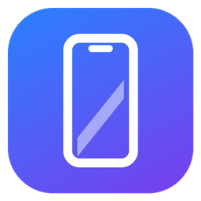

<p align="center">
  
</p>

<h1 align="center">Mirrorly</h1>

<p align="center">
  <b>See and control your iPhone from Windows, with very little delay.</b><br>
  USB or Wi-Fi · mouse and keyboard · no jailbreak, no Mac, no account.
</p>

---

Mirrorly shows your iPhone's screen in a phone-shaped window on your PC and
lets you use it with your mouse and keyboard: tap, swipe, scroll, type, go
Home, open the App Switcher. It is built for low latency: the PC adds about
1 ms; most of the remaining delay is the iPhone itself
([measurements](LATENCY.md)).

Everything stays on your computer and your network. Nothing is uploaded.

## Download

Get the latest version from [**Releases**](../../releases/latest):

- **Mirrorly-Setup-x.y.z.exe** — installer (no administrator rights needed;
  adds a Start-menu shortcut and an uninstaller), or
- **Mirrorly-x.y.z-portable.zip** — unzip anywhere and run `Mirrorly.exe`.

The app is not code-signed yet, so Windows SmartScreen may warn about it.
Choose *More info → Run anyway*, or check the file against `SHA256SUMS.txt`
in the release.

## Before the first run

1. **Install [Apple Devices](https://apps.microsoft.com/detail/9np83lwlpz9k)**
   from the Microsoft Store (free). It provides the driver Windows needs to
   talk to an iPhone. The installer offers to open the Store page if it is
   missing.
2. **iPhone**: iOS 17.4 or later, with a passcode.
3. **Plug the iPhone in, unlock it, tap Trust.**
4. **Turn on Developer Mode**: *Settings › Privacy & Security › Developer
   Mode › On*. The iPhone restarts; unlock it and tap *Turn On*. If the
   switch isn't there, start Mirrorly once with the iPhone plugged in — it
   asks iOS to show it.

The first time you open Mirrorly, a welcome screen walks you through these
steps and ticks each one off as it is done.

On the first connection Mirrorly sets up Apple's developer services on the
iPhone (the same disk image Xcode uses, signed for your phone by Apple). This
takes a moment and may repeat after the iPhone restarts.

## Using it

| Do this | To |
|---|---|
| Click / drag on the screen | Tap / swipe |
| Mouse wheel | Scroll |
| Drag up from the very bottom edge | Go Home (pause before letting go for the App Switcher) |
| Right-click | Go Home |
| Type | Type into the focused field (Ctrl+C / V / X / A / Z work as ⌘ shortcuts) |
| Point at the window | A bar appears above the screen (it never covers it, so you can still pull down Control Center): close, minimize, size · rotate, App Switcher, Home. Drag the bar to move the window |
| **Ctrl+1** / **Ctrl+2** / **Ctrl+3** | Home / App Switcher / Spotlight |
| F3 / F4 / F5 | Lock / Volume − / Volume + |
| F12 (Shift+F12) | Rotate the view for landscape apps |
| F11 | Fullscreen |
| Ctrl+wheel or the green button | Make the window bigger or smaller |

A small dot marks your click instantly, before the iPhone's own response
arrives. The iPhone always sends its screen upright, so rotate the view
yourself when an app turns sideways.

## Wi-Fi

After the first USB connection, **unplug the cable**: Mirrorly finds the
iPhone on your network and continues over Wi-Fi in about two seconds. Plug the
cable back in and it switches to USB by itself (USB is faster). An amber or
red light at the top of the screen means the Wi-Fi link is struggling.

For Wi-Fi to work:

- PC and iPhone on the **same Wi-Fi**, iPhone unlocked.
- Windows network profile **Private**: *Settings › Network & internet ›
  Wi-Fi › (your network) › Network profile type › Private*. If Windows asks
  whether Mirrorly may use private networks, allow it.
- Not a guest / hotel / apartment network that isolates devices from each
  other, and no full-tunnel VPN.
- For the smoothest picture, turn off Wi-Fi power saving: *Device Manager ›
  Network adapters › (Wi-Fi adapter) › Power Management*, untick "Allow the
  computer to turn off this device".

Wi-Fi adds a few milliseconds and the occasional hiccup; see
[LATENCY.md](LATENCY.md).

## Troubleshooting

The window tells you what it is waiting for ("Unlock your iPhone", "Turn on
Developer Mode", …). If something else goes wrong, the log is at
`%LOCALAPPDATA%\Mirrorly\logs\Mirrorly.log`; run `Mirrorly.exe --console` to
watch it live.

| Problem | Try |
|---|---|
| "Apple Devices is required" | Install Apple Devices, then replug the iPhone |
| Black screen / "iPhone is busy" | Close the Camera or any app using the camera or microphone |
| Not found over Wi-Fi | Same network? Network profile Private? VPN off? Connect by USB once |
| Choppy over Wi-Fi | Move closer to the router, use 5 GHz, turn Wi-Fi power saving off |

To forget the Wi-Fi pairing, delete `%LOCALAPPDATA%\Mirrorly\wifi\`.

---

## For developers

Rust, with a latency-first pipeline: [idevice](https://github.com/jkcoxson/idevice)
for the device protocols, FFmpeg d3d11va decoding straight into the swapchain
(zero copy), and a DXGI flip-model swapchain with a frame-latency waitable.
How it was designed and measured: [FEASIBILITY.md](FEASIBILITY.md) and
[LATENCY.md](LATENCY.md).

| Crate | Role |
|---|---|
| `crates/device` | USB (usbmuxd with TCP_NODELAY, CoreDeviceProxy) and Wi-Fi (RemotePairing, Bonjour, TLS-PSK) transports into one tunnel type; Developer Disk Image, media session, RTCP feedback, HID execution, reconnect with USB preferred (network thread) |
| `crates/video` | RTP/HEVC depacketizer (marker-bit), FFmpeg d3d11va decode into textures on the app's D3D11 device (decode thread) |
| `crates/input` | Window → screen coordinate mapping, gestures (touch vs bottom-edge system gesture), key mapping |
| `crates/app` | Window and chrome, DXGI flip-model swapchain, zero-copy NV12 render, present thread |
| `spike/`, `spike-decode/` | Phase 0 measurement tools (`s0`–`s5`) |

### Build

Requirements (Windows 10/11 x64):

- Rust stable, MSVC target: `winget install Rustlang.Rustup`
- Visual Studio 2022 Build Tools with the C++ workload:
  `winget install Microsoft.VisualStudio.2022.BuildTools --override "--quiet --wait --add Microsoft.VisualStudio.Workload.VCTools --includeRecommended"`
- LLVM (libclang for bindgen): `winget install LLVM.LLVM`
- FFmpeg 9.0 **LGPL shared** dev build unpacked to `third_party/ffmpeg`
  (`include/`, `lib/`, `bin/`), e.g. BtbN's
  `ffmpeg-n9.0-latest-win64-lgpl-shared-9.0.zip`. Never a GPL build.

```powershell
cmd /c "\"C:\Program Files (x86)\Microsoft Visual Studio\2022\BuildTools\VC\Auxiliary\Build\vcvars64.bat\" && cargo build --release"
target\release\Mirrorly.exe --console
```

Release packages (installer, portable zip, checksums) also need
`cargo install cargo-about --features cli` and Inno Setup 6
(`winget install JRSoftware.InnoSetup`):

```powershell
powershell -ExecutionPolicy Bypass -File packaging\build-release.ps1   # -> dist\
```

Options: `--vsync`, `--overlay` (F10), `--timings-csv FILE`, `--no-wifi`,
`--no-auto-ddi`, `--rctl pmd3|idevice|off`, `--console`. Diagnostics via
environment: `MIRROR_TOUCH=uhs|indigo`, `MIRROR_NAGLE=1`,
`MIRROR_DXGI_TRACE=1`, `MIRROR_SQUARE=1`. F9 runs a latency probe (10 timed
taps where the mouse points).

## License

Mirrorly is MIT-licensed ([LICENSE](LICENSE)). Releases include FFmpeg
libraries under the LGPL v3 and many Rust crates under permissive licenses;
see `THIRD-PARTY-NOTICES.txt` and `FFMPEG-NOTICE.txt` in each release.

Mirrorly is not affiliated with or endorsed by Apple Inc. iPhone, iOS and
Xcode are trademarks of Apple Inc.
